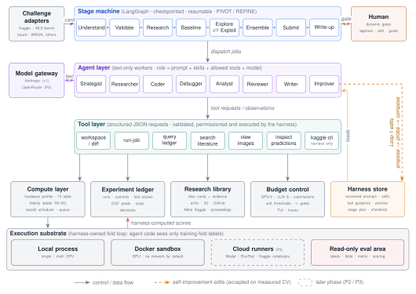

# AutoKaggle: System Design

| | |
|---|---|
| **Document** | System design specification |
| **Version** | 0.2 (draft for review) |
| **Date** | 2026-11-20 |
| **Owner** | John Roth |
| **Status** | In review. Not yet approved for implementation. |
| **Companion docs** | [challenge-candidates.md](challenge-candidates.md) · [figures/architecture.tex](figures/architecture.tex) |

### Revision history
| Version | Date | Change |
|---|---|---|
| 0.1 | 2026-11-20 | First draft: architecture, components, roadmap |
| 0.2 | 2026-11-20 | Full rewrite: requirements, interfaces, lifecycle, threat model, v1 milestones and acceptance criteria, development challenge, TikZ architecture figure |

---

## Contents
1. [Executive summary](#1-executive-summary)
2. [Background and prior art](#2-background-and-prior-art)
3. [Goals, non-goals, anti-goals](#3-goals-non-goals-anti-goals)
4. [Requirements](#4-requirements)
5. [Constraints and assumptions](#5-constraints-and-assumptions)
6. [Approaches considered](#6-approaches-considered)
7. [Architecture overview](#7-architecture-overview)
8. [Component specifications](#8-component-specifications)
9. [Run lifecycle](#9-run-lifecycle)
10. [Data model and artifacts](#10-data-model-and-artifacts)
11. [Interface contracts](#11-interface-contracts)
12. [Self-improvement](#12-self-improvement)
13. [Human-in-the-loop](#13-human-in-the-loop)
14. [Security, integrity and compliance](#14-security-integrity-and-compliance)
15. [Failure handling and recovery](#15-failure-handling-and-recovery)
16. [Budgets, cost and observability](#16-budgets-cost-and-observability)
17. [Evaluation and testing strategy](#17-evaluation-and-testing-strategy)
18. [Development challenge](#18-development-challenge)
19. [v1 scope, milestones and acceptance](#19-v1-scope-milestones-and-acceptance)
20. [Roadmap](#20-roadmap)
21. [Risks](#21-risks)
22. [Decisions log](#22-decisions-log)
23. [Open questions](#23-open-questions)
24. [Left to the builder](#24-left-to-the-builder)
25. [Glossary](#25-glossary)
26. [References](#26-references)

---

## 1. Executive summary

AutoKaggle is an open-source agent harness for Kaggle computer-vision competitions. Given a competition, it does three things:

1. It produces a **competitive solution**, and ideally a winning one.
2. It produces **research worth reading**: which ideas were tried, which helped, the ablations that show it, and the papers and past solutions behind each idea.
3. It **improves its own strategy** while it works, following the pattern of Google's Harness². Unlike Harness², every self-edit is accepted or rejected on measured scores.

**Architecture in brief**
- A deterministic orchestrator, built on **LangGraph**, owns stages, scoring, compute scheduling, budgets and human gates.
- LLM agents act as **text-only workers**: they propose ideas, write code diffs, debug, analyse errors and write reports.
- Every tool runs inside the harness. No model provider executes anything.
- The harness owns validation completely:
  - It runs each cross-validation fold itself, so agent code never sees validation labels.
  - It computes every score.
  - It trusts local CV over the public leaderboard.
- Two kinds of search share the GPU:
  - **Explore** searches broadly across solution families seeded from the literature and past Kaggle winners.
  - **Exploit** tunes hard in the style of AutoResearch.
  - A fidelity ladder keeps most experiments cheap, which is how the system adapts to whatever compute it runs on.

**Priority order:** (1) the most performant solution, (2) insightful research, (3) a useful tool. When they conflict, the higher priority wins.

**v1 at a glance.**
- Runs on local compute (one RTX 5070 Ti, 16 GB).
- Covers classification, regression and segmentation.
- Primary development target: the **Solar Filament Segmentation Challenge 2026**, instance segmentation scored by panoptic quality (PQ).
- Benchmarked on a small MLE-bench subset.
- Delivered as seven milestones, each with a machine-checkable acceptance test (§19), so it can be built incrementally by an autonomous coding agent.

---

## 2. Background and prior art

| System | What it is | What AutoKaggle takes | What AutoKaggle avoids |
|---|---|---|---|
| **AutoResearch** (Karpathy) | One agent edits a training script and keeps changes that improve a fixed-budget metric | The exploit loop: one change per run, a fixed time budget, keep only if better | One-file, one-metric scope with no validation design |
| **AIDE** (Weco) | Tree search over candidate ML solutions | Explore as a tree of solution families with ledger lineage | Greedy optimization on a single validation number |
| **AutoResearchClaw** | 23-stage research pipeline with configurable and dynamic HITL, literature search and REFINE/PIVOT | A staged pipeline, gate modes, event-driven pauses, PIVOT/REFINE transitions, citation verification | Paper-writing as the end product, and a stage count beyond what Kaggle needs |
| **Harness²** (Google Research) | Recursive improvement of an agent's harness (prompts, skills, memory, tools, scripts) with frozen weights. One loop inside a task, one across tasks. | Harness-as-files, Propose → Probe → Compose, the split between invariant and domain edits, lessons gated by evidence | Accepting edits on behavioural contrast alone. Its paper reports regressions and no held-out validation. Kaggle's ground-truth metric lets AutoKaggle do better. |
| **MLE-bench** (OpenAI) | 75 past Kaggle competitions with local grading and medal thresholds | The yardstick for the harness itself, and the held-out gate for promoting cross-competition lessons | Using it as the only measure. Live competitions remain the real test. |
| **AutoKernel, OpenResearch** | Autonomous optimization and research loops | General inspiration for long-running research loops | — |

**Why now.** Agent loops have become good enough for autonomous ML engineering, as MLE-bench results show. Recursive harness improvement now has a published method (Harness²). Nobody has combined both with the domain discipline Kaggle demands: validation design, leaderboard hygiene, ensembling and rules compliance. That combination is AutoKaggle's contribution.

---

## 3. Goals, non-goals, anti-goals

### Goals
- **G1.** End-to-end autonomy from a competition slug to the final submission, with optional human gates.
- **G2.** Adapt to the available compute, from a laptop GPU to a single workstation, multi-GPU machines and cloud. Behaviour degrades gracefully on smaller hardware.
- **G3.** Provider-agnostic LLM access: Anthropic first, then any model via OpenRouter.
- **G4.** Every score, claim and decision can be traced to an experiment record and reproduced.
- **G5.** Measurable self-improvement, within a competition (v1) and across competitions (phase 2).
- **G6.** A research report a practitioner would find insightful, with evidence behind every claim.

### Non-goals
- Training or fine-tuning LLMs. Model weights stay frozen and only the harness changes.
- Non-vision tracks (tabular, NLP, RL) before phase 4. The architecture does not rule them out.
- A hosted service. AutoKaggle is a tool you run.

### Anti-goals
Each of these counts as failure even if the software works:

| ID | Anti-goal | Primary defence |
|---|---|---|
| AG1 | **Leaderboard overfitting**: public LB climbs while the private score falls | CV is the objective. The public LB is only a correlation signal. Submission policy (§8.11). |
| AG2 | **Reward hacking**: score gains from touching labels, the metric, folds or test data | Harness-owned fold loop, read-only evaluation area, harness-computed scores (§14) |
| AG3 | **Rule violations**: multiple accounts, private sharing, disallowed data or weights, LB probing | The harness has no capability for these. Reviewer compliance checks. |
| AG4 | **Opaque wins**: scores nobody can explain or reproduce | Ledger, reproducibility bundle, research report |
| AG5 | **Polluted memory**: lessons from one competition silently mislead the next | Per-competition scratch memory is discarded. The cross-competition library is gated by evidence and a held-out benchmark (§12). |
| AG6 | **Runaway cost**: GPU or token spend beyond the user's budget | Hard budgets with soft-threshold gates (§16) |

---

## 4. Requirements

Phase tags: **v1**, **P2**, **P3**, **P4** (see §20).

### 4.1 Functional requirements

| ID | Requirement | Phase |
|---|---|---|
| FR-01 | Ingest a Kaggle competition by slug: data, rules, metric, submission format, constraints | v1 |
| FR-02 | Ingest MLE-bench competitions with local grading | v1 |
| FR-03 | Produce a competition card and an EDA report, including visual inspection of samples | v1 |
| FR-04 | Design, check and freeze a leak-free CV scheme before any modelling | v1 |
| FR-05 | Implement the competition metric locally and verify it against a reference before trusting scores | v1 |
| FR-06 | Run every training and inference job through a harness-owned fold loop | v1 |
| FR-07 | Record every experiment in a ledger: lineage, config, commit, per-fold scores, OOF and test predictions, costs | v1 |
| FR-08 | Profile hardware and size jobs to fit (fit table) | v1 |
| FR-09 | Run a fidelity ladder (R0–R3) with promotion between rungs | v1 |
| FR-10 | Exploit loop: fixed-budget, one-change, keep-if-better tuning of the current leader | v1 |
| FR-11 | Explore loop: tree search over solution families seeded by idea cards | v1 |
| FR-12 | Research engine: search arXiv, Semantic Scholar, GitHub and Meta Kaggle, and produce idea cards with evidence | v1 |
| FR-13 | Research sources: CVF Open Access, OpenReview, Hugging Face Hub | P2 |
| FR-14 | Ensemble OOF predictions (blending or stacking) and select TTA | v1 |
| FR-15 | Validate and submit through the Kaggle API under a submission policy, and select the two finals | v1 |
| FR-16 | Package code-competition inference as a Kaggle notebook plus a weights dataset, and check its runtime | P3 |
| FR-17 | Dynamic HITL gates (off / always / on-event) with approve, reject, edit, guide, skip, abort | v1 |
| FR-18 | Web dashboard and notifications for gates | P2 |
| FR-19 | Self-improvement loop 1 (within a competition, execution edits only) | v1 |
| FR-20 | Self-improvement loop 2 (cross-competition library, gated by held-out MLE-bench) | P2 |
| FR-21 | Research report, solution write-up, reproducibility bundle | v1 |
| FR-22 | Anthropic model provider | v1 |
| FR-23 | OpenRouter model provider | P2 |
| FR-24 | Task families: classification, regression, semantic and instance segmentation | v1 |
| FR-25 | Task families: detection, retrieval and metric learning, keypoints | P3 |
| FR-26 | Cloud runners (Modal, RunPod, Kaggle notebooks), multi-GPU | P3 |
| FR-27 | Non-Kaggle challenge adapters (e.g. WRIVA CVGL) | P4 |

### 4.2 Non-functional requirements

| ID | Category | Requirement |
|---|---|---|
| NFR-01 | Resumability | Kill -9 at any point loses at most the in-flight job. `run` resumes from the last checkpoint. |
| NFR-02 | Reproducibility | Any R3 experiment can be retrained from its ledger record to within seed noise |
| NFR-03 | Integrity | Agent-written code cannot read validation labels, fold assignments or metric code at any point |
| NFR-04 | Determinism of control | Given the same LLM responses, which can be recorded and replayed, the orchestrator makes the same decisions |
| NFR-05 | Cost control | No budget is exceeded by more than one in-flight job or LLM call |
| NFR-06 | Portability | Linux and WSL2 are fully supported. Native Windows is best effort. |
| NFR-07 | Provider isolation | Adding a provider touches only the model gateway |
| NFR-08 | Observability | Stage, jobs, spend and pending gates are visible live. Every LLM call and tool call is traceable. |
| NFR-09 | Security | Secrets never enter agent context. Agent code runs sandboxed with network off by default. |
| NFR-10 | Testability | Every component can be tested offline with recorded LLM responses and tiny datasets |

---

## 5. Constraints and assumptions

### Constraints
| Constraint | Source |
|---|---|
| Models return text only. All tools are implemented and executed by the harness. No provider-hosted tools or agent runtimes, and no use of Claude Code or the Claude Agent SDK as the harness. | User decision |
| Orchestration uses LangChain/LangGraph | User decision |
| Anthropic is the first provider, OpenRouter the second | User decision |
| v1 harness development uses local compute only: Windows 11, RTX 5070 Ti 16 GB | User decision |
| Kaggle competition rules must be accepted by a human in the browser before data can be downloaded | Kaggle |
| Daily submission caps, and offline time-limited notebooks for code competitions | Kaggle |
| External-data and pretrained-weight rules vary by competition | Kaggle |
| Vision datasets range from tens to hundreds of GB | Data |

### Assumptions
- **A1.** The user has a Kaggle account with API credentials and an Anthropic API key.
- **A2.** The development box runs WSL2 with CUDA support for its GPU. A Blackwell-class GPU needs a recent CUDA and PyTorch build.
- **A3.** Pretrained backbone weights (timm, Hugging Face) are downloadable at setup time.
- **A4.** The user sets a per-run LLM spend budget. Defaults are given in config.

---

## 6. Approaches considered

| | Approach | Trade-off | Verdict |
|---|---|---|---|
| A | **Claude Code as the harness.** The loop is a `program.md` plus skills, subagents and hooks. | Almost nothing to build. Weak control over long runs, scheduling and budgets. Hard to reproduce. Tied to one vendor's runtime. | Rejected: conflicts with the text-only and provider-agnostic constraints |
| B | **Deterministic orchestrator with agent workers.** Code owns stages, scoring, scheduling and budgets. Agents do the creative work. | More to build upfront. Reproducible, benchmarkable, resumable, provider-swappable. | **Chosen.** LangGraph is the orchestrator, with Harness²-style self-improvement built in. |
| C | **Single lead-researcher agent** deciding everything and spawning subagents freely | Maximum flexibility. Nondeterministic, prone to budget blowups, hard to evaluate. | Rejected as the core. Its flexibility comes back through the Strategist and self-improvement, both bounded by B. |

---

## 7. Architecture overview



*Figure 1. AutoKaggle system architecture. The source is [figures/architecture.tex](figures/architecture.tex) (TikZ). Rebuild it with `pdflatex architecture.tex && pdftocairo -svg architecture.pdf architecture.svg`.*

### 7.1 Layers
| Layer | Responsibility | Owned by |
|---|---|---|
| Challenge adapters | Fetch the challenge, produce the competition card, grade locally where possible | Harness |
| Stage machine | Sequence stages, enforce gates, checkpoint state, decide transitions | Harness (LangGraph) |
| Agent layer | Ideas, code diffs, debugging, analysis, review, writing, harness edits | LLM workers (text only) |
| Model gateway | Turn a prompt and a schema into text, per provider | Harness |
| Tool layer | Validate, authorize and execute agent tool requests | Harness |
| Core services | Compute, ledger, research library, budget control, harness store | Harness |
| Execution substrate | Run jobs sandboxed. Hold the read-only evaluation area. | Harness |

### 7.2 Design principles
1. **The harness computes every score.** Agents never report metrics.
2. **Local CV is the truth.** The public leaderboard is a sanity signal and is never optimized.
3. **Everything is an experiment record.** If it isn't in the ledger, it didn't happen.
4. **Small diffs over rewrites.** Solutions follow a standard skeleton.
5. **Cheap first, expensive last.** Ideas climb the fidelity ladder.
6. **Self-edits must pay rent.** A harness change is adopted only on measured improvement.
7. **Interfaces for the full system, implementations by phase.**
8. **Control is deterministic, content is generative.** Code makes control decisions such as transitions, promotions and budget stops, or makes them from structured agent outputs that code validates.

---

## 8. Component specifications

### 8.1 Challenge adapters

The adapter is the only layer that knows where a challenge comes from.

**Competition card**
- Task family.
- Metric (definition plus a local implementation).
- Submission format and validator.
- Data layout and size.
- Rules: external data, pretrained weights, code-competition runtime, hardware and internet limits.
- Submission cap and deadline.
- Whether late submissions are open.

**Kaggle adapter**
- Uses the official Kaggle API/CLI to download data, read the leaderboard and submit.
- Detects whether rules have been accepted. If they haven't, it halts with an instruction for the human.
- P3: packages code-competition inference.

**MLE-bench adapter**
- Prepares the competition through MLE-bench's tooling and grades locally against medal thresholds.
- Used to evaluate the harness, never as a live target.

**Metric verification (FR-05)**
- The local metric must reproduce a reference before scores are trusted. Possible references: a documented example, the organizer's evaluation notebook, MLE-bench's grader, or a first real submission.
- A failed verification blocks the Validate stage.

### 8.2 Stage machine

Built on LangGraph with a persistent checkpointer.

| Stage | Purpose | Exit criteria | Default gate |
|---|---|---|---|
| **Understand** | Competition card. EDA: class balance, image sizes and modalities, metadata, sample images viewed by agents, near-duplicates found by perceptual hashing. | Card and EDA report | off |
| **Validate** | CV design (grouped/stratified k-fold). Leakage checks: duplicates across folds, shared groups, train/test overlap. Metric verification. Fold-stability test with a cheap model. | Frozen folds, verified metric, acceptable fold variance | **always** |
| **Research** | Idea cards from the literature and past competitions. Re-entered on a plateau or PIVOT. | Ranked idea backlog | off |
| **Baseline** | Strong standard pipeline end to end, a valid submission file, a first submission | Baseline in the ledger, first CV/LB point | on-event |
| **Explore ⇄ Exploit** | Main search loop (§8.7) | Budget exhausted, plateau, or human stop | on-event |
| **Ensemble** | OOF blending or stacking, TTA selection, runtime check | Ensemble beats the best single model, or is rejected | on-event |
| **Submit** | Spend remaining submissions per policy. Select two finals. | Finals selected | **always** |
| **Write-up** | Research report, solution write-up, reproducibility bundle | Reports generated | off |

**Transitions**
- The Strategist may request **REFINE** (stay in the current family, change tactics) or **PIVOT** (return to Research or Explore with a new direction).
- The stage machine allows or refuses each request based on budget, gate policy and recent progress.
- Every transition is a Decision record (§10).

### 8.3 Agent layer

Each role is a prompt, skills, an allowed tool set, and a model assignment. All four are loaded from the harness store.

| Role | Responsibility | Tools | Model tier |
|---|---|---|---|
| **Strategist** | Choose the next experiments, request REFINE or PIVOT | query-ledger, read idea cards | strong |
| **Researcher** | Search sources and write idea cards with evidence | search-literature, fetch-source | mid (strong for synthesis) |
| **Coder** | Implement ideas as diffs against the skeleton | workspace/diff, run-job (R0 only) | strong |
| **Debugger** | Fix failed runs from logs and tracebacks | workspace/diff, read-logs, run-job (R0 only) | strong |
| **Analyst** | Error analysis: worst-k images, confusion structure, per-slice scores | view-images, inspect-predictions, query-ledger | strong, multimodal |
| **Reviewer** | Pre-flight check before R2/R3: leakage, bugs, rules and licence compliance | read-diff, read-rules | strong |
| **Writer** | Reports and write-ups from the ledger | query-ledger, read idea cards | mid |
| **Improver** | Propose harness edits (§12) | read-traces, read-harness-store | strong |

**Context policy**
- Agents get *task-scoped* context: the competition card, the relevant ledger slice, relevant idea cards and the current diff. They never get the whole history.
- Long histories are summarized into the ledger's decision records, not carried in prompts.

### 8.4 Model gateway

- **Contract.** A role, messages (text plus optional images) and an output schema go in. Text comes out, along with token and cost accounting (§11.4).
- **Model mapping.** Config maps each role to a model, with a fallback model per role.
- **Providers.** v1 uses LangChain's Anthropic integration. P2 adds LangChain's OpenRouter integration.
- **Reliability.** Retries with backoff, per-call timeouts, and rate-limit handling.
- **Accounting.** Spend is charged to the role and stage, and enforced by budget control.
- **Recording.** Every call's request and response is stored, which enables replay tests (NFR-04, NFR-10).

### 8.5 Tool layer and protocol

**Text-only protocol**
- An agent turn returns one structured JSON object (§11.3) containing:
  - a short rationale;
  - either tool requests or a final answer.
- The harness then:
  1. validates the object against the role's schema and permissions;
  2. executes the requested tools;
  3. returns observations as text, with images attached where the tool produces them.
- Invalid output gets a bounded number of repair attempts. After that, the turn fails into failure handling (§15).
- Default transport is prompt-and-parse, because not every OpenRouter model supports native function calling. The builder may use provider structured-output APIs as transport, but execution always stays in the harness.

**Tools**
| Tool | Effect | Notes |
|---|---|---|
| workspace/diff | Apply, revert or inspect diffs in the solution repo | Writes outside the solution workspace are refused |
| run-job | Queue a job at a rung | Returns a job id, never a score |
| query-ledger | Structured ledger queries | Read-only |
| search-literature / fetch-source | Research engine (§8.8) | Rate-limited and cached |
| view-images | Render samples or grids as images | For multimodal roles |
| inspect-predictions | Worst-k cases, per-class and per-slice breakdowns, overlays for segmentation | Reads OOF predictions plus labels *harness-side*. Agents see rendered results, not label files. |
| read-logs / read-diff / read-rules | Read-only views | — |
| kaggle-cli | Leaderboard reads and submissions | **The harness only.** It submits at Baseline and Submit per policy. Never granted to an agent. |

### 8.6 Workspace and solution skeleton

**Per-run solution repo**
- Each run gets its own git repository built from a task-family skeleton. v1 provides two: classification/regression and segmentation (semantic plus instance).
- Every ledger experiment points at a commit.

**Skeleton entry points (§11.2)**
- `train(samples, config) → checkpoint`
- `predict(checkpoint, samples) → predictions`

The skeleton also includes:
- data module, model and augmentation;
- loss;
- mixed precision and gradient accumulation;
- TTA hooks;
- post-processing hooks, used for instance segmentation (thresholds, instance separation, overlap resolution).

**Harness-owned fold loop.** This is the integrity core.
1. For each fold, mount only that fold's training labels and call `train`.
2. Call `predict` on the held-out images with no labels present.
3. Score the OOF predictions harness-side.

Stacking and blending run harness-side. Pseudo-labelling uses `predict` on test or unlabelled images.

**Read-only evaluation area**
- Holds the labels, fold assignments, metric and scoring code.
- It is outside agent-writable paths and is not mounted into training containers except as the per-fold training-label view.

### 8.7 Compute layer and search

**Hardware profiler**
- Measures GPU count, VRAM, throughput and disk.
- Builds a **fit table** mapping backbone × resolution × batch size to fits/doesn't fit and time per epoch.
- Re-profiles when hardware changes.

**Fidelity ladder**
| Rung | Definition | Purpose |
|---|---|---|
| R0 smoke | A few batches on a tiny subset | Catch crashes, shape errors, NaNs |
| R1 proxy | Subset, reduced resolution, 1 fold, short schedule. Cached backbone features where possible. | Rank many ideas cheaply |
| R2 single-fold | Full data, target resolution, 1 fold | Confirm the promising ideas |
| R3 full | All folds, full schedule | Ledger-grade result. OOF for ensembling. |

- **Promotion:** successive halving from R1 to R2 to R3.
- **Calibration:** the rank correlation between rungs is tracked. If R1 stops predicting R2, the harness recalibrates: bigger subsets, higher resolution or longer schedules.
- **Sizing:** rung definitions scale with the fit table. This is the primary mechanism for adapting to compute (G2).

**Two-speed search**
- **Explore:** an AIDE-style tree of solution families. Nodes are experiments, edges are diffs, and roots are idea cards. Families include backbone families, resolution regimes, losses, instance-separation strategies, pseudo-labelling and external pretraining.
- **Exploit:** an AutoResearch-style loop on the current leader. Each run makes one change (hyperparameters, augmentation strength, schedule, thresholds) under a fixed time budget. A change is kept only if CV improves beyond a **noise threshold**, estimated from seed and fold variance.
- **Scheduler:** a bandit-style allocator divides GPU time between explore and exploit by recent CV gain per GPU-hour, within budgets and gate holds.

**Runners.** All runners sit behind one interface (§11.5):
- v1: local process and Docker with GPU.
- P3: Modal, RunPod, Kaggle notebooks; multi-GPU.

### 8.8 Research engine

| Source | Access | Phase |
|---|---|---|
| Past Kaggle solutions and discussions | **Meta Kaggle**, Kaggle's official public dataset of competitions, forum topics and messages. A curated index of winning write-ups ships with the tool. Users can add links. | v1 |
| arXiv, Semantic Scholar | Public APIs | v1 |
| GitHub | Search API (stars, recency, licence) | v1 |
| CVF Open Access (CVPR/ICCV/ECCV), OpenReview (ICLR/NeurIPS) | Public pages and APIs | P2 |
| Hugging Face Hub | Model cards and weights | P2 |

Notes:
- Papers with Code was shut down in 2025 and is not a source.
- Any source beyond these requires a review of its terms of service first.

**Idea card fields**
- id and claim;
- evidence, as links with excerpts;
- where the idea worked before;
- expected gain and estimated cost (rungs or GPU-hours);
- rule compatibility;
- status (untested / testing / adopted / rejected);
- links to ledger experiments.

**Behaviour**
- Cards are claims to test, never facts.
- Citations are verified to exist, i.e. the ID resolves, following AutoResearchClaw's approach.
- Research runs up front and is re-entered on a plateau or PIVOT.

### 8.9 Analyst: vision-specific error analysis

- Renders worst-k OOF cases with predictions and ground truth overlaid, harness-side, and shows them to a multimodal model.
- Breaks performance down by class, by metadata slice (e.g. observation site or date for Solar Filament) and by object size.
- Produces structured findings, such as "small filaments near the limb are missed". These become idea cards or exploit targets.

### 8.10 Reviewer: pre-flight gate

Before any R2 or R3 job, the Reviewer checks the diff against a checklist loaded from the harness store:
- leakage patterns;
- suspicious metric-adjacent changes;
- obvious bugs;
- rules and licence compliance of new data or weights.

A Reviewer **block** stops the job. A **flag** raises an on-event HITL gate.

### 8.11 Ensemble and submission policy

**Ensemble**
- Uses R3 experiments only.
- Weights come from hill climbing or stacking on OOF, with fold-wise checks against overfitting the blend.
- Diversity is rewarded explicitly.
- TTA is chosen on OOF.
- Instance segmentation needs special handling: instance-level fusion (e.g. mask voting plus overlap resolution) rather than pixel averaging.

**Submission policy**
- Submissions are spent to measure the CV/LB relationship, not to climb the leaderboard.
- A reserve is held back for the final days.
- Two finals are selected: one with the best CV, and one robust (diverse members, lowest fold variance).
- P3: code competitions get a runtime check before the finals.

### 8.12 Reporting
- **Research report**
  - data insights;
  - validation design;
  - the experiment tree;
  - which ideas helped or hurt, with ablations;
  - CV/LB behaviour;
  - cited sources for each idea;
  - adopted harness edits, with their evidence;
  - cost breakdown.
- **Solution write-up**: a summary of the final pipeline, in the style of a Kaggle discussion post.
- **Reproducibility bundle**: commits, configs, the fold file, environment lockfile, and the commands to retrain the finals.

---

## 9. Run lifecycle

A walkthrough of a v1 run on the development challenge.

1. **`init filament-segmentation-2026`**
   - The adapter checks credentials and rule acceptance, then downloads the data.
   - It builds the card: instance segmentation, multi-annotator PQ, RLE CSV, 2048² JPEGs.
   - The profiler builds the fit table. For example, it might find a Swin-S Mask2Former fits at 1024² with batch 2 and AMP.
   - A run config is written with budgets, gate mode and model mapping.
2. **Understand**
   - EDA shows 707 images, 1–3 annotators per image, about 8.2k instances, and the date/site distribution.
   - The Analyst views samples and notes how much annotators disagree.
3. **Validate** *(gated)*
   - The agent proposes folds grouped by observation date, because same-day images come from different sites.
   - Leakage checks run.
   - The PQ implementation is verified against the organizer's evaluation reference.
   - A cheap U-Net checks fold stability.
   - A human approves.
4. **Research**
   - Idea cards from Meta Kaggle threads, arXiv (solar filament detection, Mask2Former, instance refinement) and GitHub.
   - Example card: "learned per-instance quality filter improves PQ by suppressing false positives".
5. **Baseline**
   - A Mask R-CNN or U-Net with connected components goes end to end through the fold loop to R3.
   - The submission file is validated (non-overlap, RLE) and submitted if late submissions are open.
   - The CV/LB point is recorded.
6. **Explore ⇄ Exploit**
   - The scheduler alternates between the two. Explore tries families such as Mask2Former, U-Net plus instance head, and a high-resolution refiner. Exploit tunes thresholds, minimum area, TTA views and learning rate.
   - The Analyst finds misses near the solar limb. A new idea card follows, then a crop-refinement experiment.
   - The Reviewer blocks one diff that read annotator masks inside the inference path.
7. **Loop 1 trigger**
   - Repeated OOM failures prompt an Improver edit to the Coder's skill about resolution scaling.
   - The edit is probed on the next three R1 jobs, adopted on a lower failure rate, and recorded with its evidence.
8. **Ensemble**
   - Instance-level fusion of the top-k R3 models, plus TTA.
9. **Submit**
   - The two finals are selected *(gated)*.
10. **Write-up**
    - Report, write-up and bundle.

Crash at any point → `run` resumes from the last LangGraph checkpoint. Ledger and artifacts are already durable.

---

## 10. Data model and artifacts

### 10.1 Ledger entities
| Entity | Key fields |
|---|---|
| **Run** | id, competition, harness version (store hash), config, budgets, status |
| **Experiment** | id, run, parent, idea card, commit, config, seed, rung, status, failure class |
| **Result** | experiment, per-fold scores, mean/std, OOF path, test-prediction path, curves |
| **Cost** | experiment or LLM call, GPU-seconds, wall time, peak VRAM, tokens, dollars, role, stage |
| **IdeaCard** | id, claim, evidence, expected gain or cost, rule compatibility, status |
| **Submission** | experiments, file hash, public LB, CV at submit time, timestamp, final flag |
| **Decision** | type (transition, gate, pivot, promotion, harness edit), inputs, outcome, rationale, actor (harness, agent role or human) |
| **HarnessEdit** | id, component, diff, kind (invariant or domain), probe design, evidence, verdict |
| **LLMCall** | role, model, request/response reference, tokens, latency, cost |

### 10.2 Run directory (conceptual)
```
runs/<competition>/<run-id>/
  card.*            competition card
  config.*          run config (budgets, gates, model mapping)
  readonly/         labels, folds, metric, scorer      (not agent-writable)
  solution/         git repo from task-family skeleton (agent-writable via diffs)
  artifacts/<exp>/  checkpoints, OOF/test predictions, logs, curves
  research/         idea cards, source cache
  harness/          harness-store snapshot + adopted edits for this run
  ledger.*          experiment ledger
  checkpoints/      LangGraph state
  reports/          research report, write-up, reproducibility bundle
```

---

## 11. Interface contracts

These are conceptual contracts. Concrete schemas and types are left to the builder (§24).

### 11.1 Challenge adapter
| Operation | Input | Output |
|---|---|---|
| fetch | slug | local data paths, raw rules and metadata |
| card | fetched data | competition card |
| metric | — | scorer (predictions, labels) → score; verification reference |
| validate_submission | file | ok or errors |
| submit | file, message | submission id (Kaggle) or local grade (MLE-bench) |
| leaderboard | — | public score(s) |

### 11.2 Solution skeleton
| Entry point | Input | Output | Sees labels? |
|---|---|---|---|
| train | sample ids for one fold's training part, label view for those ids, config | checkpoint | training-fold labels only |
| predict | checkpoint, sample ids, config | predictions in the task family's canonical format | never |
| postprocess *(segmentation)* | raw predictions, params | final instances or masks | never |

### 11.3 Agent turn envelope
| Field | Meaning |
|---|---|
| rationale | One or two sentences, stored in the trace |
| action | `tool_calls` (list of tool name plus arguments) or `final` (role-specific structured result) |
| confidence *(optional)* | Used by on-event gates |

### 11.4 Model gateway
| Operation | Input | Output |
|---|---|---|
| complete | role, messages (text and images), output schema, limits | text, parsed object (if a schema was given), usage and cost |

### 11.5 Runner
| Operation | Input | Output |
|---|---|---|
| submit_job | job spec (entry point, fold, rung, resources, image) | job id |
| status | job id | queued, running, done or failed, plus resource usage |
| cancel | job id | — |
| artifacts | job id | paths |

---

## 12. Self-improvement

### 12.1 The harness store
These parts are editable and versioned:
- role prompts;
- skills (markdown playbooks);
- tool guidance;
- stage plan and gate policy;
- scheduler parameters;
- Reviewer checklists.

These parts are **not** editable by agents:
- the orchestrator code;
- evaluation and scoring;
- the self-improvement procedure itself.

### 12.2 Loop 1: within a competition (v1)
1. **Trigger:** end of a stage; a plateau (no CV gain over N experiments); a repeated failure class.
2. **Propose:** the Improver reads recent traces and proposes up to *k* edits, each tagged **invariant** (a general agentic fix) or **domain** (specific to this competition or task).
3. **Probe:** the kind of probe depends on the kind of edit.
   - **Execution edits** cover the Coder, Debugger, Reviewer, Analyst and tool guidance. They don't change which ideas get tried, so the candidate and reference harnesses run the *same* next ideas, seeds and rung budget.
   - **Strategy edits** cover the Strategist, Researcher, stage plan and scheduler. They change what gets tried, so a matched probe is meaningless for them. They are queued for loop 2.
4. **Compose and accept:**
   - The decision is to adopt, merge or discard.
   - It rests on measured outcomes: CV gain per GPU-hour, failure rate, tokens per useful experiment.
   - A gain must exceed the noise threshold.
   - Each adoption writes a HarnessEdit record with its evidence.
5. **Budget:** probing is capped at a share of compute, with something like 10–15% as a starting default.

### 12.3 Loop 2: across competitions (P2)
- **Library.** Adopted edits and lessons go into the library as *claims with evidence and scope*, never as free-form notes.
- **No automatic application.** Library entries are suggestions the next run may test.
- **Strategy edits** are compared end to end under a fixed budget on MLE-bench dev competitions.
- **Promotion** into the default harness requires improvement on the **held-out** MLE-bench split. **Demotion** happens when an entry stops helping.
- **Scratch memory.** Per-competition scratch memory is discarded at the end of each run (AG5).

### 12.4 Loop 3: improving the Improver (P4, research)
Out of scope until loops 1 and 2 show measured gains. It would be held to the same held-out gate.

---

## 13. Human-in-the-loop

**Gate policies, per stage**
- **off**
- **always**
- **on-event**. Triggers:
  - a PIVOT;
  - a CV/LB divergence beyond a threshold;
  - budget at 50, 80 or 100%;
  - a Reviewer flag;
  - a harness edit above a risk level;
  - a rules question;
  - repeated failures.

**Presets**
| Preset | Gated stages |
|---|---|
| full-auto | none, except halts the harness cannot resolve |
| gate-only | Validate, Submit *(default)* |
| co-pilot | gate-only plus all on-event triggers |
| step-by-step | every stage |

**Actions at a gate**
| Action | Effect |
|---|---|
| approve | Continue |
| reject *(with reason)* | Roll back to the stage checkpoint |
| edit | Change the artifact (folds, idea card, config) |
| guide | Add a note to the Strategist's context |
| skip | Skip the stage |
| abort | Stop the run |

**Mechanism and interfaces**
- Mechanism: LangGraph interrupt and resume. Pending gates persist across restarts.
- Interfaces: CLI/TUI in v1. P2 adds a web dashboard, notifications and timeouts with a configured fallback.

---

## 14. Security, integrity and compliance

### 14.1 Threat model
| Threat | Example | Control |
|---|---|---|
| Validation-label leakage | Training code reads OOF labels or encodes them into predictions | Harness-owned fold loop. Per-fold label views. Predict never sees labels. (NFR-03) |
| Metric tampering | Agent edits the scorer or fold file | Read-only evaluation area outside writable paths. Integrity hashes checked before scoring. |
| Test-set misuse | Hand-labelling test images, or tuning on test predictions | Reviewer checklist. Test data is used only through `predict`. Pseudo-labels are always logged as such. |
| Disallowed data or weights | Using the public MAGFiLO release where the rules forbid it | Rules captured in the card. Reviewer compliance check. Data and weight provenance in the ledger. |
| Secret exfiltration | API keys in prompts or logs | Secrets live only in the harness process environment. Redaction in traces. |
| Unsafe generated code | Network calls, file-system damage | Sandbox or container. Network off by default (allowlist at setup). Resource limits. |
| Prompt injection from sources | A paper or forum post containing instructions | Source text is treated as data: delimited, quoted, never executed. Idea cards keep the provenance. |
| Leaderboard probing | Many submissions to reverse-engineer the test set | The submission policy is code. Agents have no submit capability. |

### 14.2 Compliance
- One account per user.
- No private sharing outside a team.
- Rules acceptance is always done by a human.
- Licences of external data and weights are recorded.

---

## 15. Failure handling and recovery

| Failure | Detection | Response |
|---|---|---|
| Job crash or OOM | Runner status, log signature | Debugger at R0 with bounded retries. OOM triggers a downsized config from the fit table. |
| NaN/Inf or divergence | Train curves | Fast-fail the job, mark the failure class, return it to the Debugger |
| Invalid agent output | Schema validation | Bounded repair prompts, then fail the turn and fall back to an alternative model |
| LLM outage or rate limit | Gateway errors | Backoff and retry, then fall back to the configured model, then pause the run |
| Proxy miscalibration | Rank correlation between rungs drops | Recalibrate the rungs and log a Decision |
| CV/LB divergence | Correlation tracker | On-event gate. The Analyst investigates whether it's a fold-design issue or shift. |
| Stagnation | No gain over N experiments | Research re-entry or PIVOT request, and a loop-1 trigger |
| Process kill or reboot | — | Resume from the checkpoint. In-flight jobs are re-queued idempotently. |

---

## 16. Budgets, cost and observability

**Budgets**
- Hard budgets: wall-clock, GPU-hours, LLM dollars (total and per role) and submissions.
- Soft thresholds at 50, 80 and 100% raise gates.
- NFR-05 bounds overruns to one in-flight unit.

**Model tiering.** Strong models are reserved for the Strategist, Coder, Debugger, Analyst, Reviewer and Improver. Triage and summarization use cheaper models. The gateway caches repeated research lookups.

**Live view (TUI, v1)**
- current stage;
- job queue;
- experiment leaderboard (CV and rung);
- spend against budget;
- pending gates;
- recent decisions.

**Tracing.** Every LLM call and tool call is linked to its stage, experiment and role. The backend (e.g. LangSmith or OpenTelemetry) is the builder's choice.

---

## 17. Evaluation and testing strategy

### 17.1 Evaluating the harness
- **Benchmarks.** MLE-bench vision competitions split into **dev** (for tuning) and **held-out** (for reporting and the loop-2 gate). The dev challenge is Solar Filament (§18). Tiers are listed in [challenge-candidates.md](challenge-candidates.md).
- **Headline metrics**
  - medal rate and score normalized to medal thresholds;
  - score per GPU-hour and per LLM dollar;
  - failure rate;
  - human interventions per run.
- **Release rule.** A change to the orchestrator or default harness must not regress the dev tier beyond noise. On local compute this runs on the smallest dev competitions (§19 gates).

### 17.2 Testing the software
| Level | What | How |
|---|---|---|
| Unit | Metrics (especially PQ and RLE round-trips), fold builders, schema validation, budget accounting, permission checks | Synthetic fixtures |
| Integration | Stage transitions, fold-loop integrity, runner lifecycle, resume after a kill | Tiny datasets, R0 jobs |
| Replay | Orchestrator decisions given recorded LLM responses | Recorded gateway transcripts (NFR-04) |
| Adversarial | Reward-hacking attempts, e.g. a planted diff that reads OOF labels or edits the scorer | Must be blocked or detected |
| End-to-end smoke | Full run on T0 competitions | Aerial Cactus in minutes |

---

## 18. Development challenge

**Primary target: Solar Filament Segmentation Challenge 2026** (`filament-segmentation-2026`). Full details are in [challenge-candidates.md](challenge-candidates.md).

**Why it was chosen.** At small data scale (707 images, about 0.7 GB), it exercises the hardest parts of the harness:
- **Leak-free validation design:** folds must be grouped by date across observation sites.
- **A nonstandard metric:** multi-annotator panoptic quality, with inter-annotator PQ of only about 0.34.
- **Compute adaptation:** 2048² images on a 16 GB GPU.
- **Instance-segmentation post-processing.**
- **A clear quality ladder:** naive U-Net about 0.2–0.3, strong OOF about 0.46–0.48, winning private about 0.64. These figures are self-reported by participants.

**Caveats to resolve before relying on it**
1. The competition ended on 2026-11-15. Late-submission availability is unverified.
2. The exact official PQ aggregation should be checked against the organizer's evaluation notebook.
3. External-data rules must be read, since the public MAGFiLO release is reportedly disallowed.

If late submissions are closed, development relies on local OOF plus the organizer's reference scorer. That still works, because the harness trusts CV over the LB anyway.

**Supporting set.**
- T0 smoke: Aerial Cactus.
- T1 dev, graded locally by MLE-bench: TGS Salt, Plant Pathology 2020, Plant Seedlings.
- T2 held-out: chosen from [challenge-candidates.md](challenge-candidates.md).

---

## 19. v1 scope, milestones and acceptance

**v1 scope** is the subset of §4 tagged v1. Everything outside it is designed into the interfaces but not implemented.

**How v1 will be built.** The builder is expected to be an autonomous coding agent (Claude Code). The milestones are therefore:
- ordered so that each one produces a runnable system;
- small enough to finish and verify in one focused session;
- defined by **machine-checkable acceptance criteria**, so the builder can tell on its own when a milestone is done.

| Milestone | Delivers | Acceptance criteria |
|---|---|---|
| **M0 Foundations** | Package layout, config, ledger, run directory, model gateway (Anthropic) with recording, turn envelope and tool protocol, permission model, budget accounting | Unit tests pass. A replayed recorded conversation produces identical tool executions. A tool call outside a role's permissions is refused. |
| **M1 Thin vertical slice** | MLE-bench adapter. Classification skeleton. Harness-owned fold loop. Understand → Validate → Baseline → Submit with the Coder and Debugger. Local runner. | On Aerial Cactus: an unattended run produces a valid submission, the MLE-bench grade is at or above the median, and the adversarial test (planted OOF-label read) is blocked. |
| **M2 Compute and exploit** | Hardware profiler and fit table. Rungs R0–R3 with successive halving. Docker runner. Exploit loop. Scheduler. Budgets enforced. Resume after kill. | On a T1 competition: exploit beats the M1 baseline within a fixed GPU budget. Killing the process mid-run and resuming completes the run. No budget overrun beyond one unit. |
| **M3 Research and explore** | Research engine (arXiv, Semantic Scholar, GitHub, Meta Kaggle). Idea cards. Explore tree. Strategist, Analyst and Reviewer. REFINE/PIVOT. | Idea cards cite sources whose IDs resolve. At least one idea card drives an experiment that beats the exploit-only best on a T1 competition. The Reviewer blocks the planted leakage diff. |
| **M4 Segmentation and dev challenge** | Kaggle adapter. Segmentation skeleton (semantic and instance). PQ metric with RLE I/O. Instance-level ensembling and TTA. | PQ implementation matches the organizer's reference on provided examples. A Solar Filament run with date-grouped folds reaches **OOF PQ ≥ 0.45** (strong-entry level) within 72 h on the dev box. Submission files pass format validation. |
| **M5 HITL and reporting** | Gate policies and presets. CLI/TUI. Research report, write-up, reproducibility bundle. | Validate and Submit gates pause and resume correctly across a restart. The report regenerates from the ledger alone. The bundle retrains a final model within seed noise. |
| **M6 Self-improvement loop 1** | Harness store. Improver. Matched probes for execution edits. HarnessEdit records. | Over repeated runs on T0/T1 competitions, adopted edits reduce failure rate or improve CV per GPU-hour versus a frozen harness, beyond noise. Every adoption has an evidence record. |

**v1 is done when** M0–M6 pass, and a full unattended Solar Filament run (gate-only preset) completes on the dev box with a report.

**Stretch target:** OOF PQ ≥ 0.50, plus a public LB score if late submissions are open.

*The scope proposal, the milestone order and the acceptance thresholds are my calls (§22). The thresholds are anchored on participant-reported scores and should be revisited once the official scorer is checked.*

---

## 20. Roadmap

| Phase | Scope |
|---|---|
| **v1: Core harness** | §19 |
| **P2: Breadth and memory** | OpenRouter provider. Self-improvement loop 2 (cross-competition library with held-out MLE-bench gate, strategy-edit probes). Proceedings and Hugging Face sources. Web dashboard and notifications. |
| **P3: Task and compute breadth** | Detection, retrieval/metric learning and keypoint skeletons. Cloud runners (Modal, RunPod, Kaggle notebooks). Code-competition packaging. Multi-GPU. |
| **P4: Beyond Kaggle** | Adapters for other challenges (e.g. WRIVA CVGL). Loop-3 research. Possibly non-vision tracks. |

---

## 21. Risks

| Risk | Likelihood | Impact | Mitigation |
|---|---|---|---|
| Proxy rungs don't predict full runs | Medium | High | Track rank correlation between rungs and recalibrate the ladder |
| Agents game the metric or leak labels | Medium | Critical | Fold-loop isolation, read-only area, Reviewer, adversarial tests |
| Loop-1 probes too small to detect gains on one GPU | High | Medium | Restrict to execution edits. Measure failure rate and efficiency, which are high-signal. Defer strategy edits to P2. |
| LLM spend dominates | Medium | Medium | Model tiering, budgets, caching, task-scoped context |
| 16 GB VRAM limits competitive models | Medium | Medium | Fit table, AMP, gradient accumulation, crop/tiling for high-res images. Cloud in P3. |
| Solar Filament late submissions closed | Medium | Low | Local OOF plus the organizer's scorer. CV is the objective anyway. |
| Kaggle API/ToS limits | Low | Medium | Official APIs and Meta Kaggle only |
| LangChain API churn | Medium | Low | Isolate LangChain behind the gateway and stage-machine modules |
| Scope creep | High | High | Milestone gates. Interfaces for everything, implementations by phase. |

---

## 22. Decisions log

**Decided by the user**
| # | Decision |
|---|---|
| U1 | Kaggle first, not WRIVA. Generalize later through adapters. |
| U2 | Priority: performance, then research, then usability |
| U3 | Adapt to available compute. Cloud optional later. v1 development on local compute. |
| U4 | Approach B: deterministic orchestrator with agent workers |
| U5 | LangChain/LangGraph orchestration. No Claude Code or Agent SDK harnessing. Models provide text only. |
| U6 | Claude first, then OpenRouter |
| U7 | Harness²-style recursive self-improvement is part of the harness |
| U8 | Cross-competition memory is deferred until the core works, using the evidence-and-scope design |
| U9 | MLE-bench as yardstick. CV over leaderboard. |
| U10 | Stages with dynamic HITL, as in AutoResearchClaw |
| U11 | Literature (arXiv, GitHub, proceedings) informs experiments. Big-picture research plus focused tuning. |
| U12 | The design covers the whole system with a phased roadmap |
| U13 | Solar Filament Segmentation as the development challenge, plus a candidate list |

**Calls made by the author** (open to change)
| # | Call | Reason |
|---|---|---|
| C1 | Linux/WSL2 primary runtime | Docker, NCCL and the CV stack are Linux-first |
| C2 | v1 task families: classification, regression, semantic and instance segmentation | Required by the dev challenge. Detection deferred. |
| C3 | Structured-JSON tool protocol, prompt-and-parse default transport | Portability across OpenRouter models |
| C4 | Harness-owned fold loop with per-fold label views | Only airtight defence against label leakage |
| C5 | Meta Kaggle as the past-solutions source | Official, no scraping |
| C6 | Loop 1 restricted to execution edits | Strategy edits can't be probed fairly within one competition |
| C7 | Harness performs all submissions. Agents never hold kaggle-cli. | AG1, AG3 |
| C8 | Fidelity ladder R0–R3 with successive halving | Cheapest way to adapt to compute |
| C9 | Two finals: best-CV and robust | Hedges against private-LB shift |
| C10 | v1 milestones M0–M6 and their thresholds | Incremental, machine-checkable, suits an autonomous builder |
| C11 | Gate-only as the default HITL preset | Humans check the two decisions that matter most: folds and finals |

---

## 23. Open questions

| # | Question | Blocks |
|---|---|---|
| Q1 | Default per-run LLM budget for v1 development runs | M2 budgets defaults |
| Q2 | Are Solar Filament late submissions open? What does the official PQ aggregation look like? | M4 acceptance thresholds |
| Q3 | Which T2 held-out competitions fit local disk? | §17 reporting |
| Q4 | License for the repository (e.g. Apache-2.0 or MIT) | First public release |
| Q5 | Final project name | README, package name |

---

## 24. Left to the builder

- Package layout, Python version, dependency manager.
- Ledger storage engine and artifact layout details.
- Container or sandbox technology.
- Exact JSON schemas for envelopes and tools.
- Bandit algorithm and parameters.
- Successive-halving parameters.
- Noise-threshold estimator.
- Probe-budget default.
- TUI library.
- Tracing backend.
- Exact prompt and skill content (initial harness store).

---

## 25. Glossary

| Term | Meaning |
|---|---|
| **CV** | Cross-validation. Local k-fold estimate of the private score. |
| **OOF** | Out-of-fold predictions: each training sample predicted by a model that didn't train on it |
| **LB** | Leaderboard. Public (partial test set, visible) vs private (final ranking). |
| **PQ** | Panoptic Quality. Segmentation quality × recognition quality over matched instances (IoU > 0.5). |
| **RLE** | Run-length encoding of masks |
| **TTA** | Test-time augmentation |
| **Rung** | A fidelity level on the ladder (R0–R3) |
| **Idea card** | Evidence-backed, testable claim produced by the research engine |
| **Harness store** | Versioned, agent-editable harness components |
| **Execution vs strategy edit** | A harness edit that changes how ideas are carried out vs which ideas are tried |
| **Gate** | A point where the run may pause for human input |

---

## 26. References

1. Karpathy, *AutoResearch*.
2. Weco AI, *AIDE: AI-Driven Exploration in the Space of Code*.
3. AutoResearchClaw. https://github.com/aiming-lab/AutoResearchClaw (HITL guide: `docs/HITL_GUIDE.md`)
4. *Harness²: Recursive Agent Harnessing for an Open World*, arXiv:2610.14224. https://github.com/google-research/harness2
5. OpenAI, *MLE-bench*. https://github.com/openai/mle-bench
6. LangChain / LangGraph 1.x documentation. https://docs.langchain.com
7. Solar Filament Segmentation Challenge 2026. https://www.kaggle.com/competitions/filament-segmentation-2026
8. Meta Kaggle dataset. https://www.kaggle.com/datasets/kaggle/meta-kaggle
